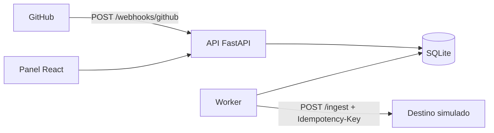

# Integrador de webhooks con reintentos y reproceso

[](https://github.com/JuanSGarciaC/integrador-webhooks/actions/workflows/ci.yml)

Servicio que **recibe webhooks de GitHub**, verifica la firma, **guarda** el evento, responde rápido (`202`) y lo **entrega a otro servicio** desde un worker aparte. Si la entrega falla, **reintenta con espera exponencial y jitter**; si se agotan los intentos, el evento queda en una cola de fallidos que se **reprocesa desde un panel**.

> Proyecto personal de portafolio con un **destino simulado**. No está probado en producción. Garantiza **entrega al menos una vez** con consumidor idempotente (no *exactly-once*).



## Ejecutarlo (Windows / PowerShell)

```powershell
cd backend; python -m venv .venv; .venv\Scripts\pip install -r requirements.txt
copy ..\.env.example .env        # y cambia WEBHOOK_SECRET
.venv\Scripts\python -m uvicorn mock_downstream.main:app --port 9000    # terminal 1: destino simulado
.venv\Scripts\python -m uvicorn app.main:app --port 8000                # terminal 2: API
.venv\Scripts\python -m app.worker                                      # terminal 3: worker
cd ..\frontend; npm install; npm run dev                                # terminal 4: panel en http://localhost:5173
.venv\Scripts\python scripts\send_webhook.py push                       # enviar un evento firmado
```

Para ver reintentos, arranca el destino con `FAILURE_RATE=0.5`. Pruebas: `cd backend; pytest --cov=app`.

## Decisiones y límites
Detalle y alternativas descartadas en [`docs/architecture.md`](docs/architecture.md). En corto: la base de datos hace de cola (*outbox*), `Idempotency-Key` = id del evento, solo se reintenta `5xx`/`429`/timeout, un `4xx` va directo a `dead`, un solo worker (con bloqueo que vence para recuperar caídas). **No** garantiza orden entre eventos, el panel **no tiene autenticación** (solo local) y SQLite no escala a varios workers.

## Pruebas y cobertura
47 pruebas (`pytest`), **92 % de cobertura de línea** medida con `pytest-cov` el 2026-10-23 (`app/main.py` y el bucle `run_forever` del worker no tienen prueba unitaria; se verificaron a mano de extremo a extremo). Colección Postman: 11 aserciones, 0 fallos con Newman en local. El `ci.yml` ejecuta pytest, comprueba `openapi.json`, compila el panel y corre Newman; los tres jobs (backend, contract, frontend) pasaron en GitHub Actions el 2026-10-23.

## Medición con fallos inyectados
Generada por `backend/scripts/simulate_load.py` (N = 200 por escenario, semilla 42). Equipo: Windows 11, Python 3.12.10. Configuración: base 2 s, factor 2, tope 300 s, jitter completo, 6 intentos máx. **Destino simulado**; la mitad de los fallos son «ack perdido» (el destino aplica el efecto y responde 503), que es lo que ejercita la idempotencia.

| Fallos inyectados | Entregados / total | `dead` | Intentos prom. | p50 (s) | p95 (s) | Aplicados en destino | Reentregas absorbidas | Duplicados efectivos |
|---|---|---|---|---|---|---|---|---|
| 0% | 200 / 200 | 0 | 1.0 | 0.0 | 0.0 | 200 | 0 | 0 |
| 30% | 200 / 200 | 0 | 1.49 | 0.0 | 3.4 | 200 | 49 | 0 |
| 60% | 194 / 200 | 6 | 2.38 | 0.5 | 16.8 | 200 | 135 | 0 |

Cómo leerla (limitaciones):
- Los tiempos (p50/p95) están en **reloj virtual**: el script avanza al siguiente `next_attempt_at` sin dormir, así que son tiempo simulado según la política de reintentos, **no latencia medida**. Con 0 % da 0 s porque no hay red.
- Al 60 % de fallos, 6 de 200 eventos terminaron en `dead` tras 6 intentos; aun así el destino aplicó los 200 efectos (en 6 casos, un «ack perdido» aplicó el efecto aunque el worker lo marcó fallido). Es la consecuencia esperable de *al menos una vez*.
- «Duplicados efectivos» = 0 es **por construcción** del destino simulado idempotente; la evidencia útil es «Reentregas absorbidas» > 0.
- Resultados completos y reproducibles en [`docs/load-results.md`](docs/load-results.md).

## Cómo se construyó
Con asistentes de IA (Claude Code). Yo revisé el diseño, ejecuté las pruebas y la medición, y soy responsable de explicar cada decisión. Diseño original: [`docs/superpowers/specs`](docs/superpowers/specs); plan: [`docs/superpowers/plans`](docs/superpowers/plans).

## Documentación
[`requirements`](docs/requirements.md) · [`architecture`](docs/architecture.md) · [`data-dictionary`](docs/data-dictionary.md) · [`test-plan`](docs/test-plan.md) · [`runbook`](docs/runbook.md) · [`risks`](docs/risks.md) · [`openapi.json`](docs/openapi.json)

## Pendiente (no hecho)
Prueba real con un repositorio de GitHub y túnel; `docker-compose.yml`; capturas del panel.
