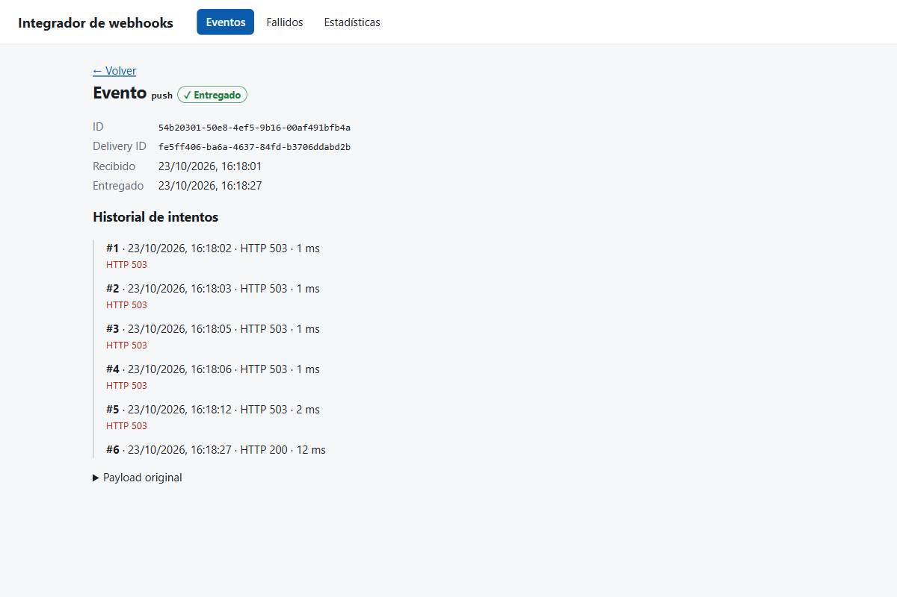
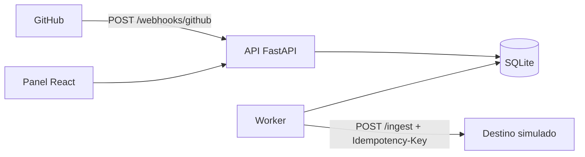
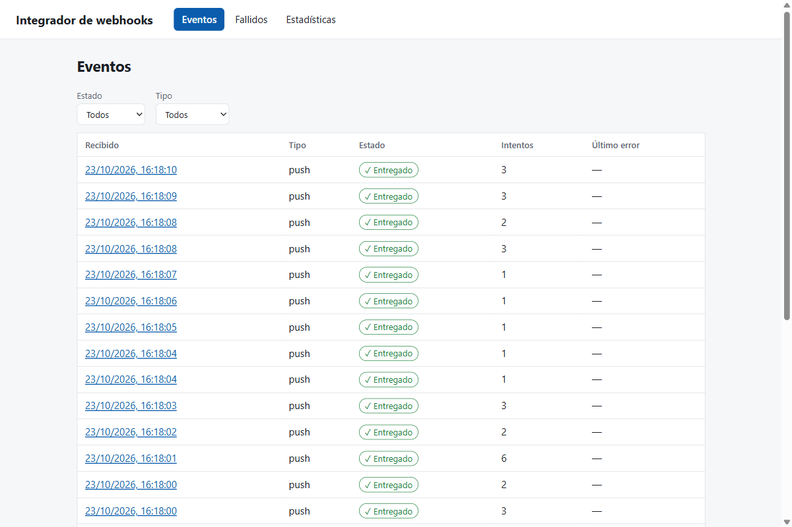
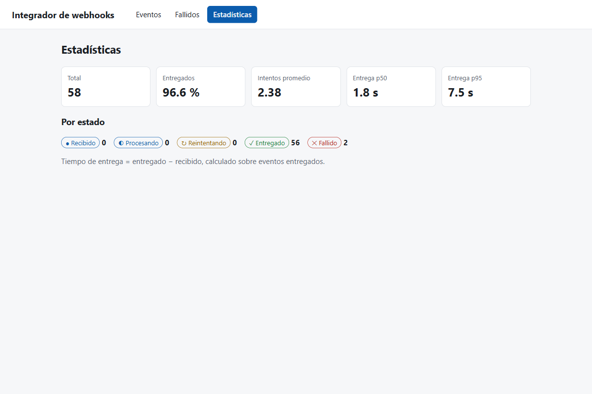
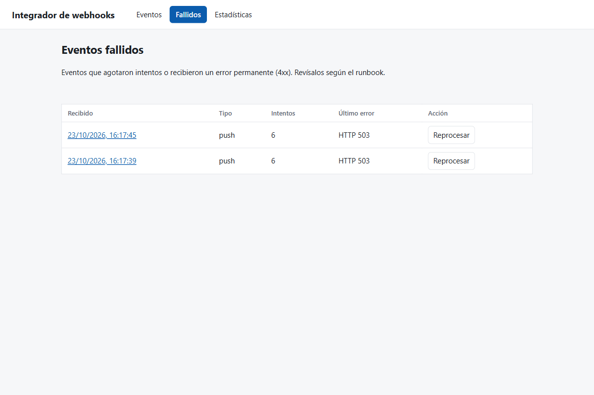

# Integrador de webhooks con reintentos y reproceso

[](https://github.com/JuanSGarciaC/integrador-webhooks/actions/workflows/ci.yml)


Servicio que **recibe webhooks de GitHub**, comprueba que son auténticos, **los guarda**, responde rápido (`202`) y **los entrega a otro servicio** desde un worker aparte. Si la entrega falla, **reintenta con espera exponencial y jitter**; si se agotan los intentos, el evento queda en una cola de fallidos que una persona **reprocesa desde un panel**.

> Proyecto personal de portafolio con un **destino simulado**. No está probado en producción. Garantiza **entrega al menos una vez** con consumidor idempotente (no *exactly-once*).



*Un evento que falló 5 veces con HTTP 503 y se entregó en el sexto intento. Datos de demostración contra un destino simulado que falla ~60 % de las veces a propósito.*

## Qué hace

| Capacidad | Cómo |
|---|---|
| Seguridad de entrada | Firma HMAC-SHA256 sobre el cuerpo crudo, comparación en tiempo constante, límite de tamaño (`413`) |
| Idempotencia | Unicidad por `(source, delivery_id)`: un reenvío responde `200` y no crea otro registro |
| Respuesta rápida | `202` al guardar; la entrega ocurre en un worker aparte (patrón *outbox*, la BD es la cola) |
| Reintentos | Espera exponencial con jitter completo, respeta `Retry-After`; solo `5xx`, `429` y timeout |
| Sin pérdida silenciosa | Tras 6 intentos (o un `4xx`) el evento pasa a `dead` y se puede reprocesar |
| Recuperación | Si el worker cae, el bloqueo (`locked_until`) vence y otro ciclo retoma el evento |
| Entrega segura al destino | Cabecera `Idempotency-Key` = id del evento; el payload se normaliza, no se envía completo |
| Observabilidad | Logs JSON por intento, `GET /api/stats` con datos reales y panel web |



## Panel

| Eventos | Estadísticas |
|---|---|
|  |  |
| **Fallidos** (con «Reprocesar») | **Detalle** |
|  |  |

Sin librerías de UI, tema claro/oscuro, el estado se comunica con icono y texto (no solo color) y foco visible.

## Ejecutarlo (Windows / PowerShell)

Requisitos: Python 3.12 y Node LTS.

```powershell
cd backend; python -m venv .venv; .venv\Scripts\pip install -r requirements.txt
copy ..\.env.example .env        # y cambia WEBHOOK_SECRET
.venv\Scripts\python -m uvicorn mock_downstream.main:app --port 9000    # terminal 1: destino simulado
.venv\Scripts\python -m uvicorn app.main:app --port 8000                # terminal 2: API
.venv\Scripts\python -m app.worker                                      # terminal 3: worker
cd ..\frontend; npm install; npm run dev                                # terminal 4: panel en http://localhost:5173
.venv\Scripts\python scripts\send_webhook.py push                       # enviar un evento firmado
```

Para ver reintentos, arranca el destino con `FAILURE_RATE=0.5`. Documentación interactiva de la API en `http://127.0.0.1:8000/docs`.

## API

| Método y ruta | Qué hace | Respuestas |
|---|---|---|
| `POST /webhooks/github` | Recibe un webhook | `202` aceptado · `200` duplicado · `400` inválido o no soportado · `401` firma · `413` tamaño |
| `GET /api/events` | Lista (filtros `status`, `event_type`, `limit`, `offset`) | `200` · `422` |
| `GET /api/events/{id}` | Detalle con historial de intentos | `200` · `404` |
| `POST /api/events/{id}/replay` | Devuelve un `dead` a la cola | `200` · `404` · `409` si no está `dead` |
| `GET /api/stats` | Conteos, intentos promedio, p50/p95 | `200` |
| `GET /health` | Estado del servicio | `200` |

Contrato en [`docs/openapi.json`](docs/openapi.json) (CI falla si cambia sin regenerarse) y colección Postman en `docs/postman/`.

## Política de reintentos

| Respuesta del destino | Acción |
|---|---|
| `2xx` | `delivered` |
| `429` | reintentar respetando `Retry-After` |
| `5xx`, timeout, error de conexión | reintentar con espera exponencial y jitter |
| `4xx` (salvo `429`) | `dead` de inmediato |
| Más de 6 intentos | `dead` |

Valores por defecto: base 2 s, factor 2, tope 5 min, jitter completo. Viven en `backend/app/config.py` y se sobrescriben por variables de entorno.

## Pruebas y cobertura
- **50 pruebas** (`pytest`) y **91 % de cobertura de línea** medida con `pytest-cov` el 2026-10-23. No tienen prueba unitaria `app/main.py` ni el bucle `run_forever` del worker; se verificaron a mano de extremo a extremo.
- Reloj y jitter inyectables: ninguna prueba usa `sleep` ni la hora real.
- Colección Postman: 11 aserciones, 0 fallos con Newman.
- CI (GitHub Actions): `pytest`, comprobación de `openapi.json`, build del panel y Newman. Los tres jobs pasaron el 2026-10-23.

```powershell
cd backend; .venv\Scripts\python -m pytest --cov=app
```

## Medición con fallos inyectados
Generada por `backend/scripts/simulate_load.py` (N = 200 por escenario, semilla 42). Equipo: Windows 11, Python 3.12.10. Configuración: base 2 s, factor 2, tope 300 s, jitter completo, 6 intentos máx. **Destino simulado**; la mitad de los fallos son «ack perdido» (el destino aplica el efecto y responde 503), que es lo que ejercita la idempotencia.

| Fallos inyectados | Entregados / total | `dead` | Intentos prom. | p50 (s) | p95 (s) | Aplicados en destino | Reentregas absorbidas | Duplicados efectivos |
|---|---|---|---|---|---|---|---|---|
| 0% | 200 / 200 | 0 | 1.0 | 0.0 | 0.0 | 200 | 0 | 0 |
| 30% | 200 / 200 | 0 | 1.49 | 0.0 | 3.4 | 200 | 49 | 0 |
| 60% | 194 / 200 | 6 | 2.38 | 0.5 | 16.8 | 200 | 135 | 0 |

Cómo leerla (limitaciones):
- Los tiempos están en **reloj virtual**: el script avanza al siguiente `next_attempt_at` sin dormir, así que son tiempo simulado según la política, **no latencia medida**. Con 0 % da 0 s porque no hay red.
- Al 60 %, 6 de 200 eventos terminaron en `dead`; aun así el destino aplicó los 200 efectos (un «ack perdido» aplicó el efecto aunque el worker lo marcó fallido). Es la consecuencia esperable de *al menos una vez*.
- «Duplicados efectivos» = 0 es **por construcción** del destino idempotente; la evidencia útil es «Reentregas absorbidas» > 0.
- Resultados completos en [`docs/load-results.md`](docs/load-results.md).

## Prueba real con GitHub
Hecha el 2026-10-23 con un repositorio de pruebas propio y un túnel temporal. Las 6 entregas reales (`ping`, `issues`, 3 `push`, `pull_request`) se aceptaron con `202`, y un *Redeliver* de GitHub se respondió `200` sin crear un registro nuevo. El túnel expone **solo** `POST /webhooks/github` mediante `backend/app/gateway.py`, porque la API de consulta no tiene autenticación. Webhook y túnel se eliminaron al terminar. Guía y resultado en [`docs/prueba-real-github.md`](docs/prueba-real-github.md).

## Decisiones y límites
Detalle y alternativas descartadas en [`docs/architecture.md`](docs/architecture.md).

- **Lo que no hace:** no garantiza orden entre eventos; el panel y `/api/*` **no tienen autenticación** (usar solo en local); un solo worker, y SQLite no escala a varios (con PostgreSQL se usaría `SKIP LOCKED`).
- **Entrega duplicada posible:** si el worker cae tras entregar y antes de registrar, o se pierde el ack, el evento puede llegar dos veces. Por eso el destino debe ser idempotente.
- **Reproceso** reinicia el contador de intentos a 0 (decisión propia, documentada).

## Documentación
[`requirements`](docs/requirements.md) · [`architecture`](docs/architecture.md) · [`data-dictionary`](docs/data-dictionary.md) · [`test-plan`](docs/test-plan.md) · [`runbook`](docs/runbook.md) · [`risks`](docs/risks.md) · [`prueba real`](docs/prueba-real-github.md) · [`openapi.json`](docs/openapi.json)

## Cómo se construyó
Con asistentes de IA. Yo revisé el diseño, ejecuté las pruebas y la medición 

## Licencia
[MIT](LICENSE) © 2026 JuanSGarciaC
