# Integrador de webhooks con reintentos y reproceso

[](https://github.com/JuanSGarciaC/integrador-webhooks/actions/workflows/ci.yml)


Servicio que **recibe webhooks de GitHub**, comprueba que son auténticos, **los guarda**, responde rápido (`202`) y **los entrega a otro servicio** desde un worker aparte. Si la entrega falla, **reintenta con espera exponencial y jitter**; si se agotan los intentos, el evento queda en una cola de fallidos que una persona **reprocesa desde un panel**.

> Proyecto personal de portafolio con un **destino simulado**. No está probado en producción. Garantiza **entrega al menos una vez** con consumidor idempotente (no *exactly-once*).

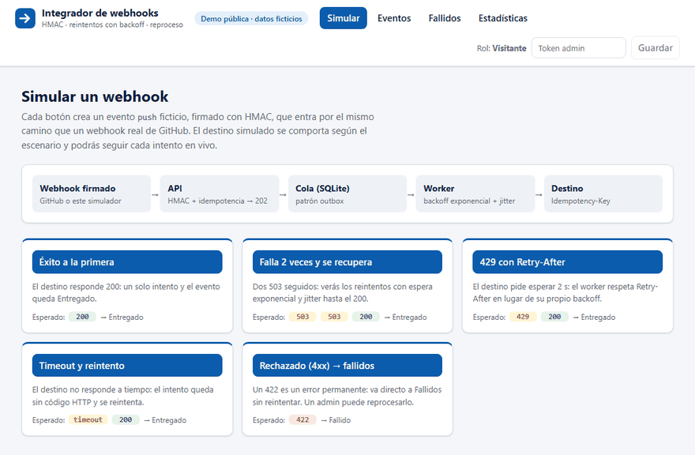

*Grabado el 2026-11-11 contra el contenedor local: «Falla 2 veces y se recupera» → dos `503` → espera con backoff y jitter → `200` y Entregado. Datos ficticios contra el destino simulado.*

## Demo en vivo

**👉 [integrador-webhooks-demo.onrender.com](https://integrador-webhooks-demo.onrender.com)** · API interactiva en [`/docs`](https://integrador-webhooks-demo.onrender.com/docs)

La demo pública corre en un solo contenedor (API + worker + destino simulado + panel) en Render, con el blueprint [`render.yaml`](render.yaml).

Qué probar en la demo:
1. **Simular**: elige un escenario (éxito, falla 2 veces y se recupera, `429` con `Retry-After`, timeout, rechazado `4xx`). El evento es ficticio, va firmado con HMAC y entra por el mismo camino que un webhook real de GitHub.
2. **Detalle**: el evento se actualiza en vivo y muestra cada intento con su código HTTP y duración.
3. **Fallidos**: el reproceso está protegido. Un visitante ve «Requiere admin» y la API responde `401`. Con el token admin, el evento rechazado se reprocesa y se entrega.

Límites de la demo: los datos son ficticios y se borran cuando el servicio se duerme (plan gratuito, tras 15 min sin tráfico). El primer acceso tarda alrededor de 1 minuto en despertar. Cada IP puede hacer 10 simulaciones por minuto y se guardan como máximo 500 eventos (se purgan los terminados más antiguos).

## Qué hace

| Capacidad | Cómo |
|---|---|
| Seguridad de entrada | Firma HMAC-SHA256 sobre el cuerpo crudo, comparación en tiempo constante, límite de tamaño (`413`) |
| Idempotencia | Unicidad por `(source, delivery_id)`: un reenvío responde `200` y no crea otro registro |
| Respuesta rápida | `202` al guardar; la entrega ocurre en un worker aparte (patrón *outbox*, la BD es la cola) |
| Reintentos | Espera exponencial con jitter completo, respeta `Retry-After`; solo `5xx`, `429` y timeout |
| Sin pérdida silenciosa | Tras 6 intentos (o un `4xx`) el evento pasa a `dead` y se puede reprocesar |
| Recuperación | Si el worker cae, el bloqueo (`locked_until`) vence y otro ciclo retoma el evento |
| Entrega segura al destino | Cabecera `Idempotency-Key` = id del evento; el payload se normaliza, no se envía completo |
| Destino real opcional | Con `DOWNSTREAM_FORMAT=triaje` entrega issues abiertos a [triaje-solicitudes](#conexión-con-triaje-solicitudes) |
| Observabilidad | Logs JSON por intento, `GET /api/stats` con datos reales y panel web |
| Autorización | `/api/*` exige token Bearer de admin (comparación en tiempo constante). En la demo, el visitante anónimo solo lee y simula; reprocesar siempre es admin |

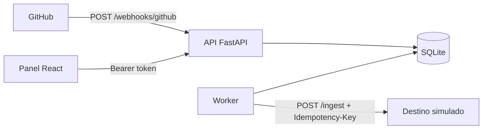

## Panel

**Lienzo del recorrido**: Webhook → API → Cola → Worker → Destino, con rama a Fallidos. En «Simular» muestra los conteos reales y las aristas fluyen solo por donde pasaron eventos.

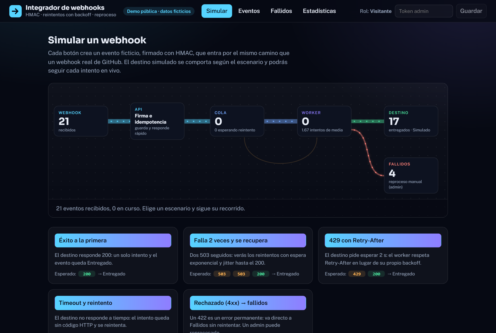

En el detalle, el lienzo sigue a ese evento: un punto recorre cada tramo, el Worker gira mientras hay un intento en curso y la Cola late con la cuenta atrás hasta el siguiente reintento.

| Detalle en vivo (esperando el reintento) | Detalle terminado |
|---|---|
| 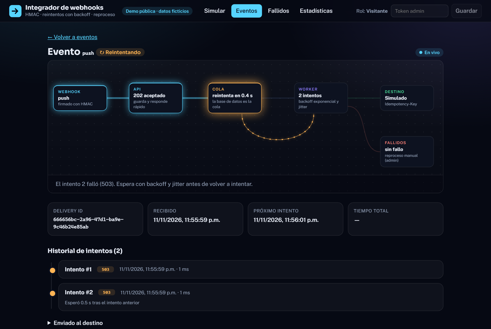 | 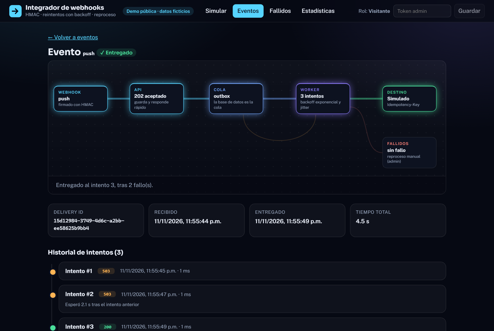 |
| **Eventos** | **Estadísticas** |
| 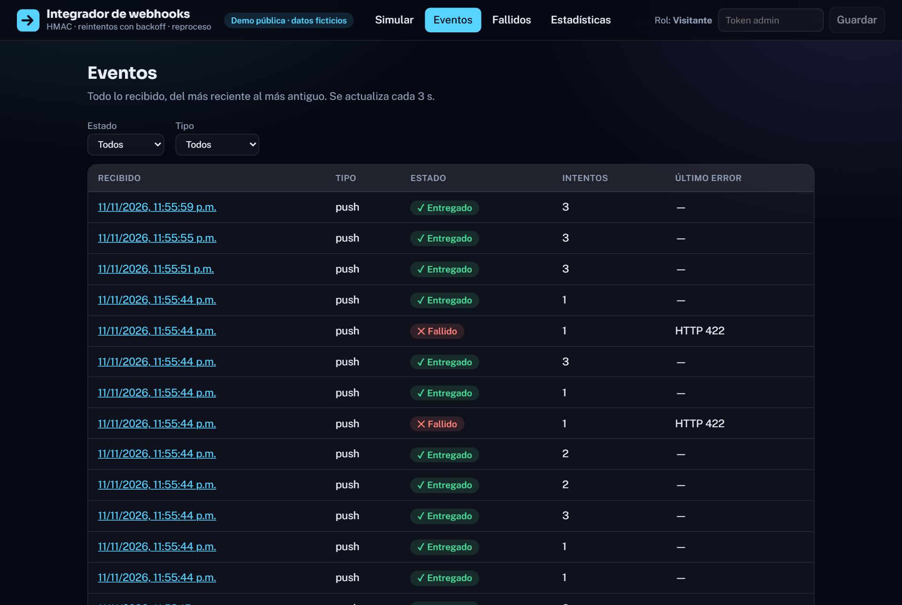 | 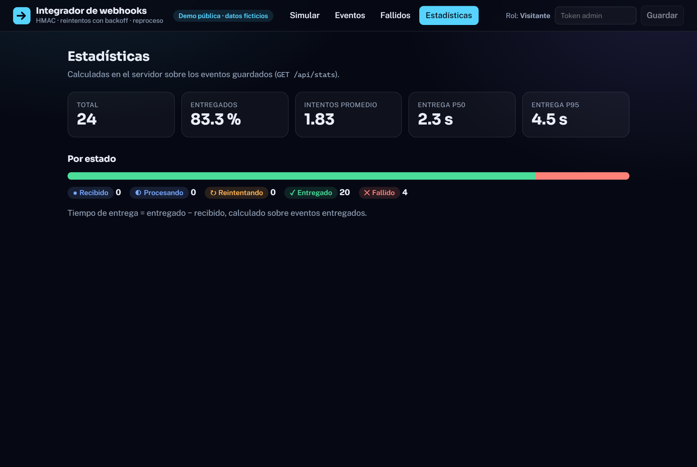 |
| **Fallidos como visitante**: reprocesar bloqueado | **Fallidos como admin**: reprocesar habilitado |
| 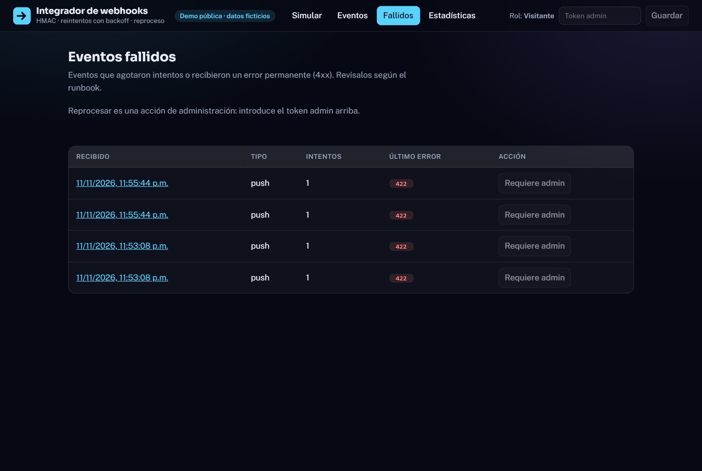 | 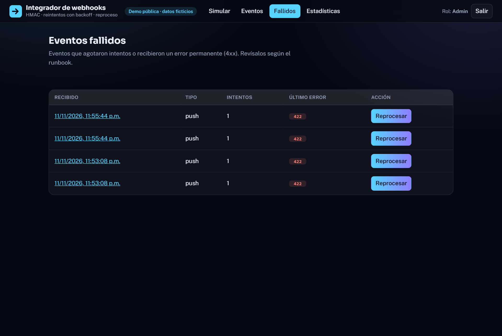 |

Sin librerías de UI. Tema oscuro. El estado se comunica con icono y texto, no solo con color; el foco es visible y todo el movimiento se apaga con `prefers-reduced-motion`. El detalle muestra también «Enviado al destino»: el JSON que sale hacia el destino, junto al payload original. Capturas y GIF tomados el 2026-11-11 contra el contenedor local con `frontend/scripts/capture.mjs`, `frames.mjs` y `gif.py` (datos sembrados con el simulador).

## Conexión con triaje-solicitudes

El destino puede ser un servicio real: [triaje-solicitudes](https://github.com/JuanSGarciaC/triaje-solicitudes), que clasifica solicitudes de soporte. Un issue recién abierto en GitHub entra al integrador, que lo traduce al contrato de triaje y lo entrega con reintentos; triaje lo clasifica y decide si lo aprueba solo o lo manda a una persona.

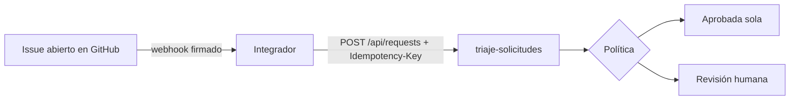

| El issue en el integrador | El mismo issue en triaje |
|---|---|
| 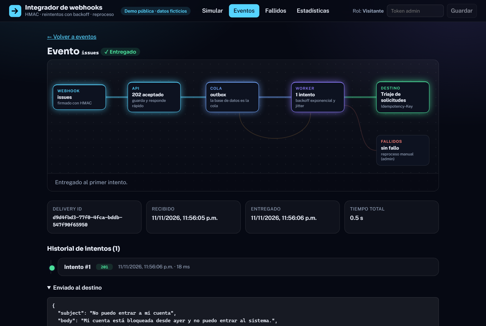 | 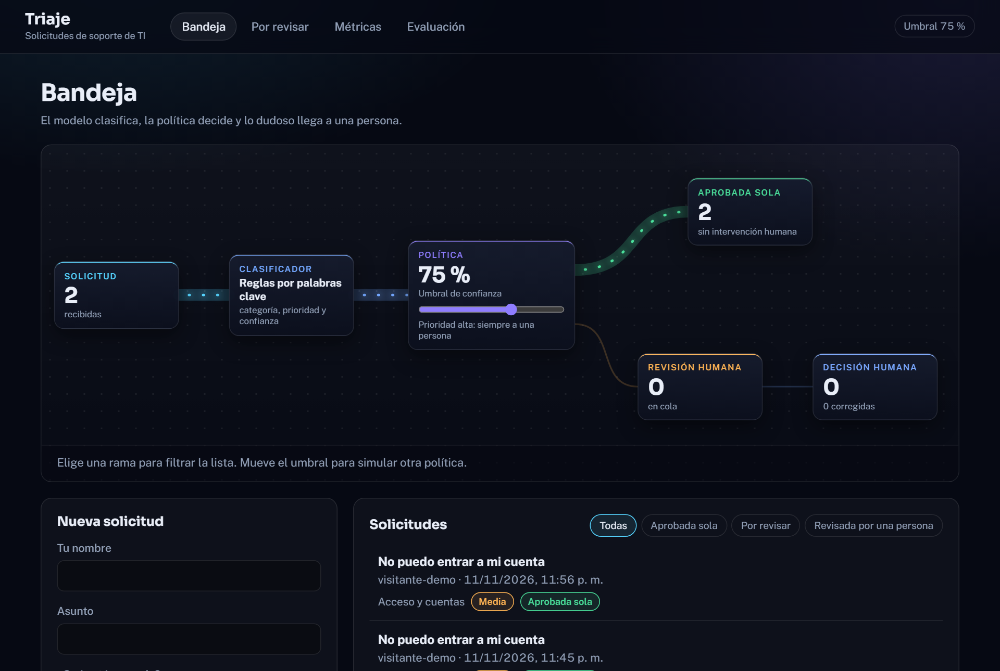 |

```powershell
$env:WEBHOOK_SECRET="algo-secreto"; $env:ADMIN_TOKEN="otro-secreto"
docker compose -f docker-compose.triaje.yml up -d --build --wait
# integrador en http://localhost:8080 (Simular → «Issue nuevo → triaje») y triaje en http://localhost:8081
```

Cómo funciona (`DOWNSTREAM_FORMAT=triaje`; sin esa variable todo sigue igual, con el destino simulado):

- **El integrador se adapta al destino.** Envía `subject` (título), `body` (cuerpo del issue) y `requester` (usuario), recortados a los límites de triaje. Es el único caso en que sale contenido del payload, y nunca el payload completo.
- **Sin duplicados.** La entrega es *al menos una vez*, así que triaje respeta `Idempotency-Key`: un reenvío del mismo evento devuelve la solicitud original y no se clasifica de nuevo.
- **Solo issues recién abiertos.** Lo demás (`push`, issues editados o cerrados) se responde `200` con `ignorado` y no se guarda.
- **Repositorios separados.** El compose construye triaje desde su repositorio, fijado a un commit, con el clasificador de reglas (sin API de pago).

Límites: los dos servicios hablan sin autenticación por la red interna del compose, y las demos públicas no están conectadas (la de triaje no acepta texto libre). Con triaje como destino, el simulador ofrece un solo escenario: un issue ficticio.

## Ejecutarlo (Windows / PowerShell)

Requisitos: Python 3.12 y Node LTS.

```powershell
cd backend; python -m venv .venv; .venv\Scripts\pip install -r requirements.txt
copy ..\.env.example .env        # y cambia WEBHOOK_SECRET y ADMIN_TOKEN
.venv\Scripts\python -m uvicorn mock_downstream.main:app --port 9000    # terminal 1: destino simulado
.venv\Scripts\python -m uvicorn app.main:app --port 8000                # terminal 2: API
.venv\Scripts\python -m app.worker                                      # terminal 3: worker
cd ..\frontend; npm install; npm run dev                                # terminal 4: panel en http://localhost:5173
.venv\Scripts\python scripts\send_webhook.py push                       # enviar un evento firmado
```

En el panel, escribe el valor de `ADMIN_TOKEN` en «Token admin»: fuera del modo demo, toda la API de consulta lo exige. El token se guarda solo en la pestaña (`sessionStorage`). Para ver reintentos, arranca el destino con `FAILURE_RATE=0.5`. Documentación interactiva de la API en `http://127.0.0.1:8000/docs`.

La demo completa en un contenedor (requiere Docker):

```powershell
docker build -t integrador-demo .
docker run --rm -p 8080:8080 -e WEBHOOK_SECRET=algo-secreto -e ADMIN_TOKEN=otro-secreto integrador-demo
# panel en http://localhost:8080 ; sin WEBHOOK_SECRET o ADMIN_TOKEN el contenedor no arranca
```

## API

| Método y ruta | Qué hace | Respuestas |
|---|---|---|
| `POST /webhooks/github` | Recibe un webhook | `202` aceptado · `200` duplicado o ignorado · `400` inválido o no soportado · `401` firma · `413` tamaño |
| `GET /api/events` | Lista (filtros `status`, `event_type`, `limit`, `offset`) | `200` · `401` · `422` |
| `GET /api/events/{id}` | Detalle con historial de intentos y lo enviado al destino (`outbound`) | `200` · `401` · `404` |
| `POST /api/events/{id}/replay` | Devuelve un `dead` a la cola (**solo admin**) | `200` · `401` · `404` · `409` si no está `dead` |
| `GET /api/stats` | Conteos, intentos promedio, p50/p95 | `200` · `401` |
| `GET /api/demo` | ¿Está activo el modo demo? ¿Cuál es el destino? (público) | `200` |
| `POST /api/demo/simulate` | Solo con `DEMO_MODE`: crea un evento ficticio de un escenario | `202` · `401` · `422` · `429` |
| `GET /health` | Estado del servicio | `200` |

**Quién puede qué:**

| | Visitante (sin demo) | Visitante en modo demo | Admin (`Authorization: Bearer <ADMIN_TOKEN>`) |
|---|---|---|---|
| Leer `/api/*` | `401` | sí | sí |
| Simular | no existe (`404`) | sí, con límite por IP | sí (solo en demo) |
| Reprocesar | `401` | `401` | sí |

Un token incorrecto da `401` también en la demo: nunca se trata como visitante anónimo. Si `ADMIN_TOKEN` está vacío, nadie es admin.

Contrato en [`docs/openapi.json`](docs/openapi.json) (CI falla si cambia sin regenerarse) y colección Postman en `docs/postman/`.

## Política de reintentos

| Respuesta del destino | Acción |
|---|---|
| `2xx` | `delivered` |
| `429` | reintentar respetando `Retry-After` |
| `5xx`, timeout, error de conexión | reintentar con espera exponencial y jitter |
| `4xx` (salvo `429`) | `dead` de inmediato |
| Más de 6 intentos | `dead` |

Valores por defecto: base 2 s, factor 2, tope 5 min, jitter completo. Viven en `backend/app/config.py` y se sobrescriben por variables de entorno.

## Pruebas y cobertura

| Capa | Qué | Reloj | Resultado medido (2026-11-11, local) |
|---|---|---|---|
| Unitarias e integración | `backend/tests/` con `pytest` | virtual (`FakeClock`, jitter fijo, sin `sleep`) | **115 pruebas** y **94 % de cobertura de línea** |
| Contrato | Newman, `docs/postman/` y `--check` de `openapi.json` | real | 13 peticiones, 13 aserciones, 0 fallos |
| E2E API | `backend/tests_e2e/` contra el contenedor | **real** | 9 pruebas pasan |
| E2E panel | Playwright, `frontend/e2e/` contra el contenedor | **real** | 3 pruebas pasan |
| E2E conexión | `tests_e2e/test_triaje_e2e.py` contra integrador + triaje (`docker-compose.triaje.yml`) | **real** | 2 pruebas pasan |

- Sin prueba unitaria: `app/main.py` y el bucle `run_forever` del worker. Los cubren los E2E, que arrancan la imagen real.
- CI (GitHub Actions) tiene cinco jobs: `backend`, `contract`, `frontend` (build), `e2e` y `e2e-triaje`. El job `e2e` construye la **misma imagen que se despliega** y ejecuta pytest y Playwright contra ella; `e2e-triaje` levanta integrador y triaje juntos y comprueba que un issue llega clasificado y que un reenvío no lo duplica.
- Matriz detallada en [`docs/test-plan.md`](docs/test-plan.md).

```powershell
cd backend; .venv\Scripts\python -m pytest --cov=app                                     # unitarias
docker run -d -p 8080:8080 -e WEBHOOK_SECRET=s -e ADMIN_TOKEN=t -e DEMO_RATE_PER_MINUTE=1000 integrador-demo
$env:WEBHOOK_SECRET="s"; $env:ADMIN_TOKEN="t"; .venv\Scripts\python -m pytest tests_e2e   # E2E API
cd ..\frontend; npx playwright install chromium; npm run e2e                                # E2E panel
```

## Medición con fallos inyectados
Generada por `backend/scripts/simulate_load.py` (N = 200 por escenario, semilla 42). Equipo: Windows 11, Python 3.12.10. Configuración: base 2 s, factor 2, tope 300 s, jitter completo, 6 intentos máx. **Destino simulado**; la mitad de los fallos son «ack perdido» (el destino aplica el efecto y responde 503), que es lo que ejercita la idempotencia.

| Fallos inyectados | Entregados / total | `dead` | Intentos prom. | p50 (s) | p95 (s) | Aplicados en destino | Reentregas absorbidas | Duplicados efectivos |
|---|---|---|---|---|---|---|---|---|
| 0% | 200 / 200 | 0 | 1.0 | 0.0 | 0.0 | 200 | 0 | 0 |
| 30% | 200 / 200 | 0 | 1.49 | 0.0 | 3.4 | 200 | 49 | 0 |
| 60% | 194 / 200 | 6 | 2.38 | 0.5 | 16.8 | 200 | 135 | 0 |

Cómo leerla (limitaciones):
- Los tiempos están en **reloj virtual**: el script avanza al siguiente `next_attempt_at` sin dormir, así que son tiempo simulado según la política, **no latencia medida**. Con 0 % da 0 s porque no hay red.
- Al 60 %, 6 de 200 eventos terminaron en `dead`; aun así el destino aplicó los 200 efectos (un «ack perdido» aplicó el efecto aunque el worker lo marcó fallido). Es la consecuencia esperable de *al menos una vez*.
- «Duplicados efectivos» = 0 es **por construcción** del destino idempotente; la evidencia útil es «Reentregas absorbidas» > 0.
- Resultados completos en [`docs/load-results.md`](docs/load-results.md).

## Prueba real con GitHub
Hecha el 2026-10-23 con un repositorio de pruebas propio y un túnel temporal. Las 6 entregas reales (`ping`, `issues`, 3 `push`, `pull_request`) se aceptaron con `202`, y un *Redeliver* de GitHub se respondió `200` sin crear un registro nuevo. El túnel expone **solo** `POST /webhooks/github` mediante `backend/app/gateway.py`, porque entonces la API de consulta aún no tenía autenticación. Webhook y túnel se eliminaron al terminar. Guía y resultado en [`docs/prueba-real-github.md`](docs/prueba-real-github.md).

## Decisiones y límites
Detalle y alternativas descartadas en [`docs/architecture.md`](docs/architecture.md).

- **Lo que no hace:** no garantiza orden entre eventos. La autorización es un único token admin compartido, sin usuarios ni expiración: suficiente para una demo, no para un equipo (ahí se usaría OIDC con roles). Usa un solo worker, y SQLite no escala a varios (con PostgreSQL se usaría `SKIP LOCKED`).
- **Límite por IP de la demo:** vive en memoria y por proceso, así que solo vale con un contenedor. La IP se toma de `True-Client-IP` (la fija Cloudflare delante de Render), nunca de `X-Forwarded-For`, que el cliente puede falsear.
- **Entrega duplicada posible:** si el worker cae tras entregar y antes de registrar, o se pierde el ack, el evento puede llegar dos veces. Por eso el destino debe ser idempotente.
- **Reproceso** reinicia el contador de intentos a 0 (decisión propia, documentada).

## Documentación
[`requirements`](docs/requirements.md) · [`architecture`](docs/architecture.md) · [`data-dictionary`](docs/data-dictionary.md) · [`test-plan`](docs/test-plan.md) · [`runbook`](docs/runbook.md) · [`risks`](docs/risks.md) · [`prueba real`](docs/prueba-real-github.md) · [`openapi.json`](docs/openapi.json)

## Cómo se construyó
Con asistentes de IA. Yo revisé el diseño, ejecuté las pruebas y la medición 

## Licencia
[MIT](LICENSE) © 2026 JuanSGarciaC
