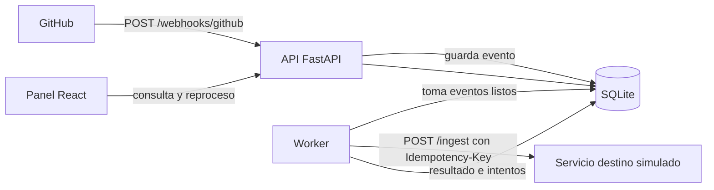
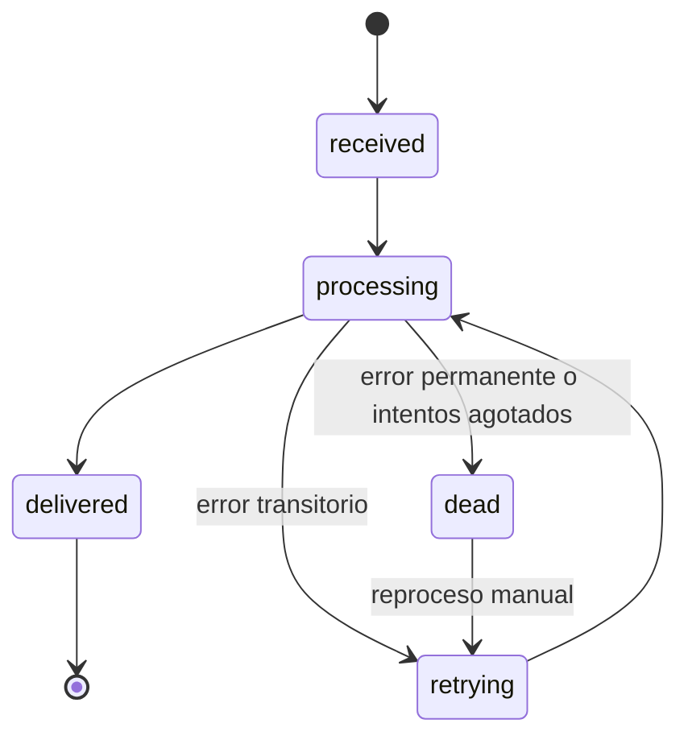

# Arquitectura

## Decisiones y alternativas descartadas

| Decisión | Alternativa descartada | Razón / límite |
|---|---|---|
| Responder `202` y procesar en un worker | Procesar dentro de la petición | Evita timeouts y reenvíos del emisor. Añade un pequeño retraso |
| La BD es la cola (*outbox*) | Redis/RabbitMQ/Kafka | Cero infraestructura; el evento no se pierde si cae el worker. No escala a muchos workers (con PostgreSQL: `SKIP LOCKED`) |
| Unicidad `(source, delivery_id)` | Deduplicar por hash del cuerpo | GitHub identifica cada entrega; el duplicado devuelve `200` |
| `claim_due` con UPDATE condicional (compare-and-set) | Leer y luego escribir sin condición | Dos workers nunca toman el mismo evento |
| `Idempotency-Key` = id del evento | Generar una clave nueva por intento | Un reintento no duplica el efecto en el destino |
| Reintentar solo `5xx`, `429`, timeout | Reintentar todo | Un `400` fallará igual; va a `dead` |
| Espera exponencial con jitter completo, respeta `Retry-After` | Espera fija | No sobrecarga un destino caído; evita reintentos sincronizados |
| Reproceso reinicia `attempts` a 0 | Conservar el conteo | Si no, el evento moriría tras un solo intento (**decisión propia**, no está en el diseño original) |
| Un solo worker | Pool de workers | Simplicidad y pruebas deterministas; el bloqueo vencido recupera caídas |
| Panel sin router ni UI kit | React Router / librería de UI | Cuatro vistas; cero dependencias extra |
| Zonas horarias: UTC ingenuo en BD | `datetime` con zona | SQLite no conserva la zona; el panel interpreta como UTC |

## Límites honestos
No garantiza orden entre eventos, no autentica a los usuarios del panel (corre solo en local) y no está probado en producción. Un evento puede entregarse más de una vez (si el worker cae tras entregar y antes de registrar, o si se pierde el ack): por eso el destino debe ser idempotente.
