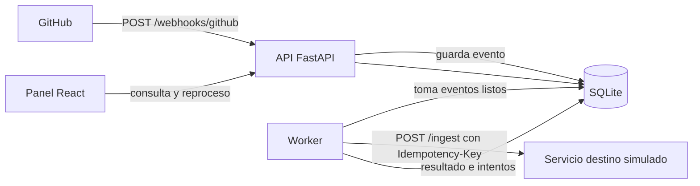
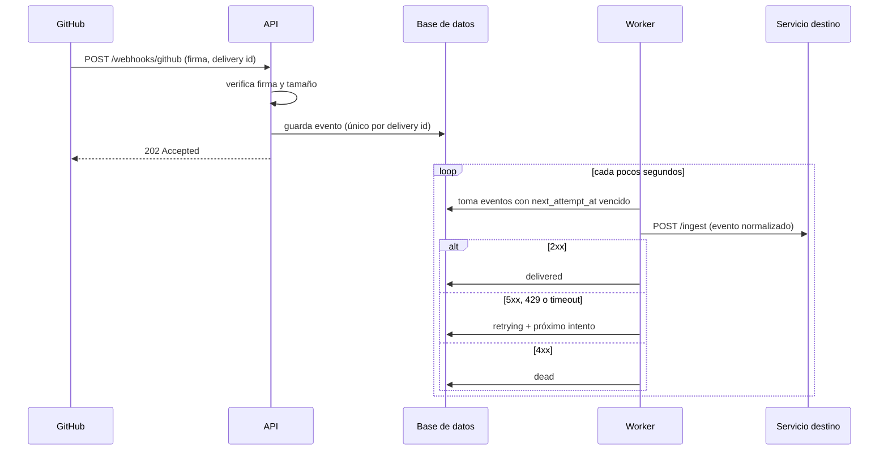
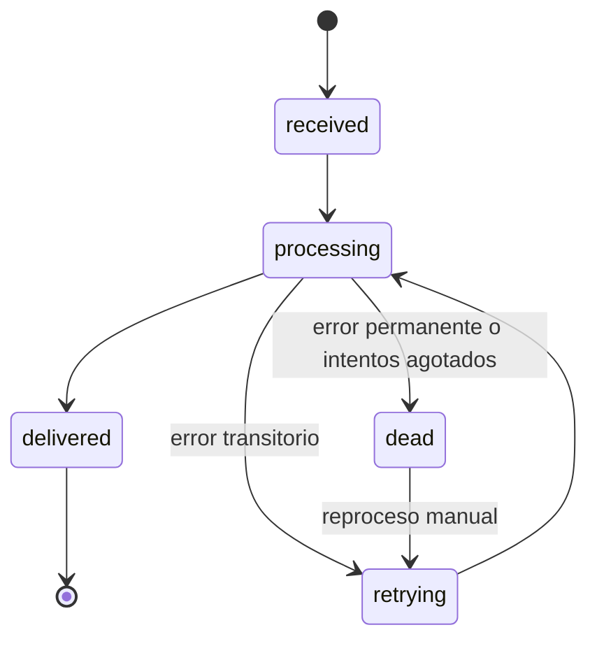

# Proyecto · Integrador de webhooks con reintentos y reproceso

> Plan completo y estructura principal. Nombre sugerido del repositorio: `integrador-webhooks`.
> Perfil que respalda: *API Integration Analyst* (principal) y *Systems / Process Analyst* (por la documentación).

## 0. Estado de este documento

- Es el **plan y la estructura**: arquitectura, contrato de la API, modelo de datos, pruebas, fases y criterios de "listo". **Aún no incluye código.**
- Los datos técnicos de GitHub (nombres de cabeceras, límites, tiempos) están escritos de memoria. **Verifícalos en la documentación vigente de GitHub Webhooks** antes de implementarlos.
- Nada de aquí fue probado. Cuando quieras, el siguiente paso es un código de partida verificado, como en los proyectos anteriores.

## 1. Qué es y por qué sirve en tu portafolio

Un servicio que **recibe webhooks de GitHub**, comprueba que son auténticos, **los guarda de forma segura**, los transforma a un formato común y los **entrega a otro servicio** (un destino simulado que fallará a propósito). Si la entrega falla, **reintenta con espera creciente**; si se agotan los intentos, el evento queda en una cola de fallidos que una persona puede **reprocesar desde un panel**.

| Qué demuestra | Dónde se ve |
|---|---|
| Integración de APIs de extremo a extremo | recepción, transformación y entrega |
| Seguridad básica de APIs | verificación de firma HMAC, límite de tamaño, secretos en variables de entorno |
| Fiabilidad: idempotencia, reintentos, cola de fallidos | `retry.py`, `worker.py`, tabla de eventos |
| Diseño de contratos | OpenAPI exportado y colección de Postman ejecutada en CI |
| Calidad y pruebas (tu base en QA) | pruebas unitarias, de integración y de fallos inyectados |
| Análisis de sistemas | `docs/`: requisitos, criterios de aceptación, diccionario de datos, runbook |

**Qué NO afirmar en CV ni entrevistas:**
- No digas "entrega exactamente una vez" (*exactly-once*). Lo correcto es: **entrega al menos una vez, con consumidor idempotente**.
- No cites rendimiento (eventos por segundo) ni tasas de éxito que no salgan de tu propia medición (sección 16).
- No lo presentes como sistema en producción: es un proyecto personal con un destino simulado.
- Declara que lo construiste con asistentes de IA y que tú revisaste, probaste y mediste.

## 2. Alcance

**Dentro (MVP):**
1. Recibir webhooks de GitHub (`push`, `issues`, `pull_request` y `ping`).
2. Verificar firma e impedir duplicados.
3. Guardar el evento y responder rápido.
4. Procesar en un worker aparte: normalizar y entregar a un destino HTTP.
5. Reintentos con espera exponencial y variación aleatoria (*jitter*); cola de fallidos con reproceso manual.
6. API de consulta y panel web.
7. Pruebas, CI y documentación de analista.

**Fuera (para no inflarlo):** múltiples fuentes además de GitHub, autenticación de usuarios del panel, balanceo entre varios workers, Kafka/RabbitMQ/Redis, despliegue en la nube. Algunos aparecen como mejoras futuras.

## 3. Arquitectura



**Flujo de un evento:**



## 4. Decisiones de diseño (para defenderlas en entrevista)

| Decisión | Razón | Límite honesto |
|---|---|---|
| Responder `202` y procesar aparte | El emisor espera una respuesta rápida; procesar dentro de la petición arriesga timeouts y reenvíos | Hay un pequeño retraso entre recibir y entregar |
| La base de datos hace de cola (patrón *outbox*) | Cero infraestructura extra; el evento no se pierde si el worker cae | No escala a muchos workers; con PostgreSQL se usaría `SKIP LOCKED` |
| Unicidad por `(source, delivery_id)` | GitHub puede reenviar el mismo evento; el duplicado se responde `200` sin reprocesar | Si cambia la forma de identificar entregas, hay que ajustar |
| `Idempotency-Key` hacia el destino | Un reintento no debe duplicar el efecto en el destino | El destino simulado debe implementarlo; uno real puede no hacerlo |
| Reintentar solo errores transitorios (5xx, 429, timeout) | Reintentar un 400 nunca lo arregla | Un 4xx por mala configuración requiere intervención humana |
| Espera exponencial con *jitter*, respetando `Retry-After` | Evita sobrecargar a un destino ya caído y que todos reintenten a la vez | Más lento en recuperarse |
| Cola de fallidos con reproceso manual | Ningún evento se descarta en silencio | Requiere que alguien la revise (por eso existe el runbook) |
| Comparar firmas en tiempo constante | Evita ataques por tiempos de respuesta | Solo protege la autenticidad, no el contenido sensible |
| Un solo worker en el MVP | Simplicidad y comportamiento fácil de probar | Una caída del worker detiene las entregas; hay recuperación por bloqueo vencido |

## 5. Contrato de la API

| Método y ruta | Qué hace | Respuestas |
|---|---|---|
| `POST /webhooks/github` | Recibe un webhook | `202` aceptado; `200` duplicado; `400` JSON inválido o evento no soportado; `401` firma inválida o ausente; `413` cuerpo demasiado grande |
| `GET /api/events` | Lista eventos con filtros `status`, `event_type`, `limit`, `offset` | `200`; `422` parámetros inválidos |
| `GET /api/events/{id}` | Detalle con historial de intentos | `200`; `404` |
| `POST /api/events/{id}/replay` | Devuelve un evento fallido a la cola | `200`; `404`; `409` si no está en `dead` |
| `GET /api/stats` | Conteos por estado, intentos promedio, tiempos | `200` |
| `GET /health` | Estado del servicio | `200` |

**Destino simulado (`mock_downstream`):** `POST /ingest` (respuesta según una tasa de fallos y una de límite de uso configurables), `GET /received` (para verificar en pruebas qué se recibió).

## 6. Modelo de datos

**`events`**

| Campo | Tipo | Nota |
|---|---|---|
| `id` | UUID | clave primaria |
| `source` | texto | por ahora `github` |
| `delivery_id` | texto | único junto con `source` |
| `event_type` | texto | `push`, `issues`, `pull_request`, `ping` |
| `payload` | JSON (texto) | cuerpo original |
| `status` | texto | `received`, `processing`, `retrying`, `delivered`, `dead` |
| `attempts` | entero | intentos hechos |
| `next_attempt_at` | fecha | cuándo puede intentarse |
| `locked_until` | fecha | bloqueo del worker; permite recuperar eventos atascados |
| `last_error` | texto | último error legible |
| `received_at`, `delivered_at` | fecha | para medir tiempos |

**`delivery_attempts`:** `id`, `event_id`, `attempted_at`, `http_status` (puede ser nulo), `duration_ms`, `error`.

**Formato normalizado hacia el destino:** `event_id`, `source`, `type`, `repository`, `actor`, `summary`, `occurred_at`. No envíes el payload completo.



## 7. Política de reintentos

| Resultado del destino | Acción |
|---|---|
| `2xx` | `delivered` |
| `429` | reintentar; respetar `Retry-After` si viene |
| `5xx`, timeout, error de conexión | reintentar con espera exponencial y jitter |
| `4xx` (menos `429`) | `dead` de inmediato: reintentar no lo arregla |
| Más de N intentos (sugerido 6) | `dead` |

Valores iniciales sugeridos (ajústalos y documenta por qué): base 2 s, factor 2, tope 5 minutos, jitter completo. Todos deben vivir en `config.py`, no en el código.

## 8. Estructura del repositorio

```text
integrador-webhooks/
  README.md
  AGENTS.md
  .env.example
  .gitignore
  docker-compose.yml            # fase 7, opcional
  docs/
    requirements.md             # historias de usuario y criterios de aceptación
    architecture.md             # diagramas y decisiones
    data-dictionary.md
    test-plan.md
    runbook.md                  # qué hacer si crece la cola de fallidos
    risks.md
    openapi.json                # generado, no escrito a mano
    postman/integrador.postman_collection.json
  backend/
    requirements.txt
    pytest.ini
    app/
      __init__.py
      config.py                 # variables de entorno y parámetros de reintento
      database.py
      models.py
      schemas.py
      security.py               # verificación de firma
      mapping.py                # normalización de eventos
      retry.py                  # espera, jitter y clasificación de errores
      repository.py             # acceso a datos: tomar, marcar, reprocesar
      api.py                    # rutas
      worker.py                 # bucle del worker (python -m app.worker)
    mock_downstream/
      main.py                   # destino simulado
    scripts/
      send_webhook.py           # envía eventos firmados de ejemplo
      simulate_load.py          # carga con fallos inyectados y reporte real
    tests/
      conftest.py
      test_security.py
      test_mapping.py
      test_retry.py
      test_webhook_api.py
      test_worker_flow.py
      test_replay.py
  frontend/
    package.json
    vite.config.ts
    tsconfig.json
    index.html
    src/
      main.tsx
      App.tsx
      api.ts
      types.ts
      styles.css
      pages/
        Events.tsx
        EventDetail.tsx
        DeadLetters.tsx
        Stats.tsx
  .github/workflows/ci.yml
```

## 9. Stack

| Capa | Herramienta | Por qué |
|---|---|---|
| API | Python 3.12, FastAPI, Pydantic | Ya lo usaste en el proyecto de triaje; genera OpenAPI solo |
| Datos | SQLite con SQLAlchemy | Sin configuración; activa el modo WAL para mejorar la concurrencia |
| Cliente HTTP | `httpx` | Tiempos límite claros y fácil de simular en pruebas |
| Pruebas | `pytest`, `pytest-cov`, `httpx.MockTransport` | Sin dependencias extra para simular el destino |
| Contrato | OpenAPI exportado + Postman/Newman | Newman ejecuta la colección en CI |
| Panel | React + Vite + TypeScript, CSS propio | Como en tus proyectos anteriores |
| CI | GitHub Actions | pytest, build del panel y Newman |

## 10. Plan de pruebas

| Nivel | Qué cubre | Ejemplos |
|---|---|---|
| Unitarias | funciones puras | firma válida, inválida, ausente y con mayúsculas; cálculo de espera con jitter fijado por semilla; clasificación de códigos HTTP; mapeo de cada tipo de evento |
| Integración | API con base de datos de prueba | `202` válido, `401` firma inválida, `200` duplicado sin crear un segundo registro, `413`, `400` |
| Flujo del worker | worker + destino simulado en memoria | entrega a la primera; entrega tras 2 fallos; `4xx` va directo a `dead`; agotar intentos; recuperar un evento con bloqueo vencido; el reintento envía la misma `Idempotency-Key` |
| Reproceso | API + worker | `dead` → `retrying` → `delivered`; `409` si el estado no es `dead` |
| Contrato | OpenAPI y Postman | colección ejecutada con Newman en CI |
| Fallos inyectados | `simulate_load.py` | tasa de fallos 0%, 30% y 60% (sección 16) |

Mide la cobertura con `pytest-cov` y **publica el número real**, sin fijar una meta artificial. Una cobertura alta con pruebas vacías no aporta nada.

## 11. Seguridad (lista de verificación)

- [ ] El secreto del webhook vive en `.env`, nunca en el código ni en el repositorio.
- [ ] La firma se calcula sobre el **cuerpo crudo** de la petición, antes de convertirlo a JSON.
- [ ] La comparación de firmas usa una función de tiempo constante.
- [ ] Hay límite de tamaño del cuerpo y de tiempo en las llamadas salientes.
- [ ] Los registros (logs) no incluyen secretos ni el payload completo.
- [ ] El panel no se expone a internet sin autenticación (en el MVP corre solo en tu equipo).
- [ ] Si usas un túnel para recibir webhooks reales: úsalo solo mientras pruebas, no publiques la URL y borra el webhook al terminar.
- [ ] Usa un repositorio de pruebas propio. No conectes repositorios de empresas ni de terceros.

## 12. Observabilidad

- Registros estructurados (una línea JSON por evento) con `event_id`, `delivery_id`, `status` y `attempt`.
- `GET /api/stats` calculado con datos reales de la base.
- El panel muestra el historial de intentos de cada evento.

## 13. Panel web (brief de diseño)

Un panel de operaciones sobrio, de tarea clara: ver qué entró, qué falló y qué reprocesar.

- **Eventos:** tabla con filtros por estado y tipo, y orden por fecha.
- **Detalle:** historial de intentos como línea de tiempo, con código HTTP, duración y error.
- **Fallidos:** lista de eventos en `dead` con botón "Reprocesar" y confirmación.
- **Estadísticas:** porcentaje entregado, intentos promedio, tiempo hasta la entrega (percentiles calculados de datos reales).
- **Reglas visuales:** sin librerías de UI; variables CSS; tema claro y oscuro; el estado nunca se comunica solo con color (usa texto o icono); foco visible; vacíos explicados ("Aún no hay eventos. Envía uno con `send_webhook.py`").

## 14. Documentación de analista (tu diferenciador)

Estos archivos respaldan el perfil de análisis de sistemas con casi nada de código:

| Archivo | Contenido |
|---|---|
| `requirements.md` | 8 a 12 historias de usuario con criterios de aceptación verificables (formato "dado, cuando, entonces"), por ejemplo: *dado un webhook con firma inválida, cuando llega, entonces se responde 401 y no se guarda* |
| `architecture.md` | Diagramas de la sección 3 y las decisiones de la sección 4 con sus alternativas descartadas |
| `data-dictionary.md` | Cada campo de las tablas: tipo, significado, valores permitidos |
| `test-plan.md` | La tabla de la sección 10 enlazada a cada criterio de aceptación |
| `runbook.md` | Qué hacer si crece la cola de fallidos, si el worker no avanza o si el destino está caído |
| `risks.md` | Riesgos del proyecto y mitigaciones (sección 18) |

## 15. Integración continua

El flujo de `ci.yml` debe: instalar dependencias, ejecutar `pytest` con cobertura, generar `openapi.json` y fallar si cambió sin haberlo confirmado, compilar el panel y ejecutar la colección de Postman con Newman contra una instancia de prueba. Un distintivo de CI en verde en el README es parte del entregable.

## 16. Medición honesta

Crea `simulate_load.py` para enviar **N eventos firmados** (sugerido: 200) con el destino configurado a **0%, 30% y 60%** de fallos, y reporta por escenario, con datos de la base:

| Métrica | Cómo se calcula |
|---|---|
| Entregados / total | eventos en `delivered` |
| Fallidos (`dead`) | eventos en `dead` |
| Intentos promedio por evento | promedio de `attempts` |
| Tiempo hasta la entrega (p50 y p95) | `delivered_at − received_at` |
| Duplicados efectivos en el destino | cuántas veces el destino aplicó el mismo `Idempotency-Key` (debe ser 0) |

En el README publica la tabla **con tus números reales**, indicando fecha, equipo, versión, valores de configuración y que el destino es simulado. No redondees hacia arriba ni estimes. Si algún resultado es malo (por ejemplo, muchos `dead` al 60%), cuéntalo y explícalo: es más valioso que un resultado perfecto.

**Prueba real opcional con GitHub:** crea un repositorio de pruebas propio, añade un webhook con tu secreto y un túnel temporal, genera eventos (`push`, `issues`) y usa la función "Redeliver" de GitHub para comprobar que el duplicado se detecta. Verifica las condiciones vigentes del servicio de túnel que uses.

## 17. Plan por fases

Antes de empezar, pega las reglas de la sección 19 en `AGENTS.md`.

**Fase 0 · Entorno y documentos.** Crea la carpeta, `git init`, entorno virtual y los borradores de `docs/requirements.md` y `docs/architecture.md`.
*Listo cuando:* tienes al menos 8 historias con criterios de aceptación y el diagrama de la sección 3.

**Fase 1 · Recepción segura.** `security.py` y la ruta `POST /webhooks/github` (sin guardar todavía, o con una lista en memoria).
*Prompt:* "Implementa la verificación de firma HMAC-SHA256 sobre el cuerpo crudo con comparación en tiempo constante, con pruebas para firma válida, inválida y ausente. Explícame cada decisión."
*Listo cuando:* firma inválida da `401`, la válida da `202`, y las pruebas pasan.

**Fase 2 · Persistencia e idempotencia.** Modelos, repositorio y unicidad por `(source, delivery_id)`.
*Listo cuando:* un mismo `delivery_id` enviado dos veces crea un solo registro y responde `200` la segunda vez.

**Fase 3 · Worker, reintentos y destino simulado.** `retry.py`, `worker.py` y `mock_downstream`.
*Prompt:* "Implementa la política de la sección 7 con jitter inyectable para poder probarla de forma determinista. Escribe las pruebas antes del código."
*Listo cuando:* las pruebas de la sección 10 pasan, incluida la recuperación de un evento con bloqueo vencido.

**Fase 4 · API de consulta, reproceso y contrato.** Rutas `GET`, `replay`, `stats`; exportar `openapi.json`; colección de Postman.
*Listo cuando:* Newman pasa en local y el reproceso lleva un evento de `dead` a `delivered`.

**Fase 5 · Panel web.** Páginas de la sección 13.
*Listo cuando:* puedes enviar eventos con el script, verlos cambiar de estado y reprocesar uno fallido desde el panel.

**Fase 6 · Fallos inyectados y documentación.** `simulate_load.py`, la tabla de la sección 16 y los documentos restantes de `docs/`.
*Listo cuando:* tienes una tabla con números reales y el runbook escrito.

**Fase 7 · Pulido y publicación.** README, CI en verde, capturas y, opcionalmente, `docker-compose.yml`.
*Listo cuando:* alguien que no conoce el proyecto puede ejecutarlo siguiendo solo el README.

## 18. Riesgos y mitigaciones

| Riesgo | Mitigación |
|---|---|
| Querer añadir demasiado (Redis, Kafka, nube) | El alcance de la sección 2 es el contrato; lo extra va a "mejoras futuras" |
| SQLite bloqueado con worker y API a la vez | Modo WAL, transacciones cortas, un solo worker en el MVP |
| Pruebas que dependen del tiempo real | Reloj y jitter inyectables; no uses `sleep` en las pruebas |
| Código que no puedes explicar | Regla de `AGENTS.md`: cada cambio se explica antes de aceptarlo |
| Exponer secretos o URLs de túnel | Lista de la sección 11 antes de cada commit |
| Resultados inflados | Solo cifras de `simulate_load.py` con tu equipo, y se cuentan las malas |

## 19. Reglas para Cursor, Grok, ChatGPT y Antigravity

Pégalas en `AGENTS.md` y al inicio de cada conversación nueva:

```text
Eres mi mentor de programación. Estoy construyendo un proyecto de portafolio y debo poder explicar cada parte en una entrevista.
Reglas:
1. Explica en español sencillo qué cambias y por qué, antes de cambiarlo.
2. Un cambio pequeño a la vez; ejecuta las pruebas después de cada uno.
3. Escribe primero la prueba y luego el código cuando sea posible.
4. No cambies la arquitectura, las dependencias ni la estructura de carpetas sin preguntarme.
5. Nunca escribas secretos en el código; van en .env, que no se sube a GitHub.
6. Nunca inventes métricas ni resultados; si algo no está medido, dilo.
7. No uses sleep ni la hora real en las pruebas; inyecta el reloj.
8. Si una prueba falla, muestra el error completo y la causa más probable antes de editar.
9. No uses datos reales de personas ni conectes repositorios que no sean míos.
```

Preparación en Windows 11: igual que en las guías anteriores (Python 3.12, Node LTS, Git). Si decides usar Docker en la fase 7, necesitarás Docker Desktop; verifica sus requisitos y condiciones de licencia vigentes.

## 20. Publicación en GitHub

- README con: problema, diagrama, cómo ejecutarlo en 5 comandos, decisiones y límites, la tabla de la sección 16 y capturas del panel.
- Sección "Cómo se construyó" que diga que usaste asistentes de IA y que tú revisaste, probaste y mediste.
- Descripción del repositorio y topics: `webhooks`, `fastapi`, `idempotency`, `retries`, `api-integration`, `python`, `react`.
- Verifica que `.env` no esté en el repositorio y que no haya secretos en el historial.
- Cuando lo publiques, avísame y actualizo tu CV, `profile.yml` y `_profile.md` con el enlace y tus cifras reales.

**Plantilla de viñeta para el CV (completa solo con tus números):**
> Servicio de integración que recibe webhooks de GitHub con verificación de firma, idempotencia y reintentos con espera exponencial. En pruebas con fallos inyectados de [X]% (destino simulado), se entregaron [Y] de [N] eventos y [Z] pasaron a la cola de fallidos [cifras de mi ejecución del [fecha]].

## 21. Cómo contarlo en entrevista

**Estructura de 90 segundos:** problema → diseño → fiabilidad → cómo lo medí.

> "Construí un servicio que recibe webhooks de GitHub, verifica la firma, responde rápido y entrega los eventos a otro servicio con reintentos. Lo más interesante fue la fiabilidad: garantizo entrega al menos una vez, y evito duplicar efectos con una clave de idempotencia. Lo probé con fallos inyectados y medí [resultado real]."

Preguntas probables y por dónde responder:
- *¿Por qué responder 202 y procesar aparte?* Porque el emisor espera una respuesta rápida y reenvía si no la recibe; procesar aparte evita timeouts. Verifica el límite de tiempo vigente de GitHub.
- *¿Entrega exactamente una vez?* No: al menos una vez, con consumidor idempotente. Explica la diferencia.
- *¿Por qué no reintentas un 400?* Porque el mismo mensaje fallará igual; pasa a la cola de fallidos para intervención.
- *¿Qué pasa si el worker se cae a mitad de un evento?* El bloqueo vence y otro ciclo lo recupera; por eso la entrega es "al menos una vez".
- *¿Cómo escalarías esto?* PostgreSQL con `SKIP LOCKED`, varios workers, y quizá una cola dedicada; reconoce que el MVP no está pensado para eso.
- *¿Por qué comparar firmas en tiempo constante?* Para evitar fugas de información por diferencias de tiempo.
- *¿Qué no hace el sistema?* No garantiza orden entre eventos, no autentica usuarios del panel y no está probado en producción.

## 22. Mejoras futuras (elige una, no todas)

- Segunda fuente de webhooks con otro esquema de firma.
- Interruptor de circuito (*circuit breaker*) hacia el destino.
- PostgreSQL y varios workers, con una prueba de concurrencia.
- Métricas en formato Prometheus.
- Alertas por correo o Telegram cuando la cola de fallidos supere un umbral.
